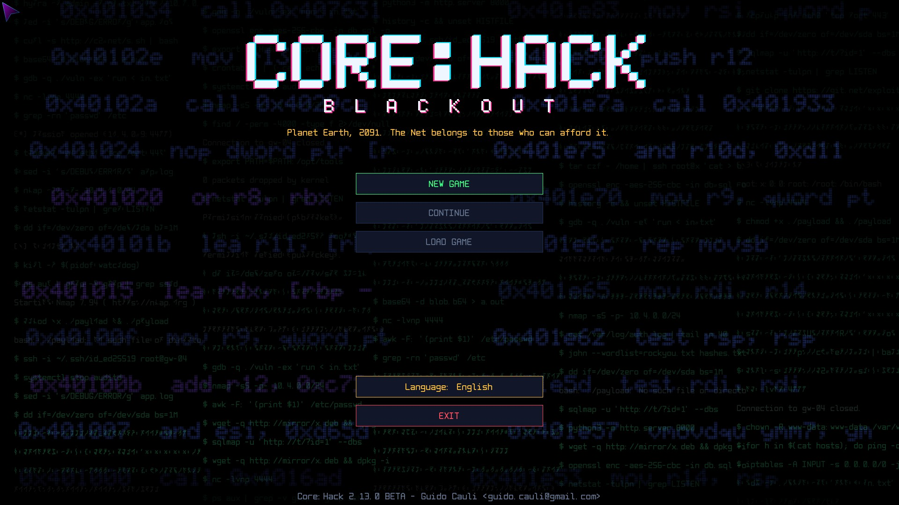
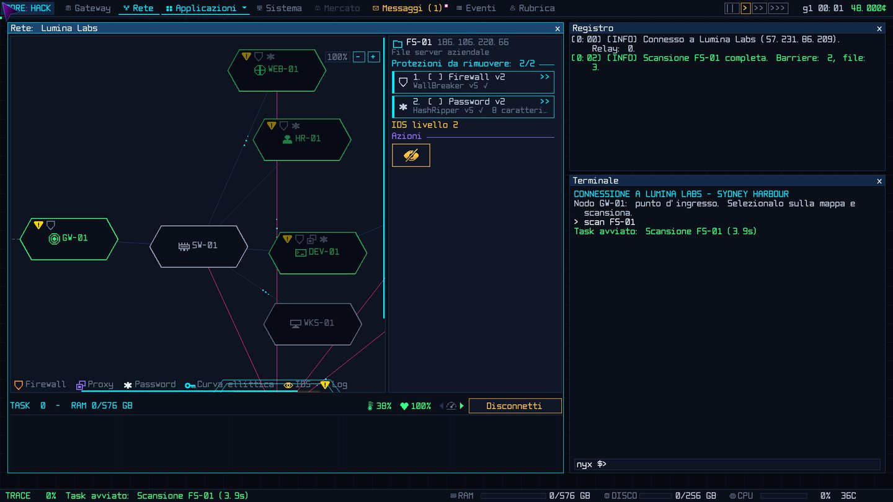
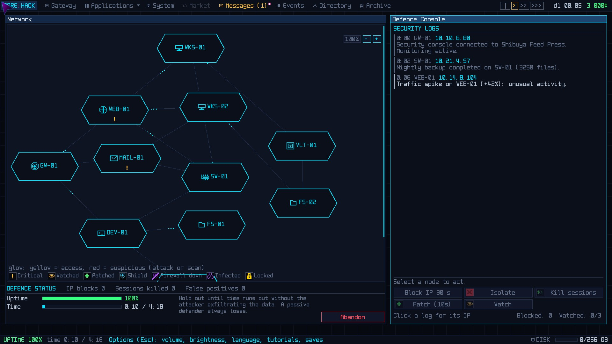

# Core:Hack: Blackout

*Core:Hack 2.10.2 - Guido Cauli <guido.cauli@gmail.com>*

**English** · [Italiano](README.it.md)



> Planet Earth, 2091. The Net belongs to whoever can afford it.

A real-time cyberpunk hacking sim. You are an independent operator with an old gateway and a terminal: you take intrusion and defence contracts, build a reputation with four factions and decide, job after job, which side you are on.

Free, with nothing behind a paywall. Linux, Windows and macOS, in Italian, English and French.

## Download

| System | Package |
|---|---|
| Windows 10/11, 64-bit | [corehack-windows-amd64.zip](../../releases/latest/download/corehack-windows-amd64.zip) |
| macOS 12+, Apple Silicon | [corehack-macos-silicon.zip](../../releases/latest/download/corehack-macos-silicon.zip) |
| Linux x86-64 | [corehack-linux-amd64.tar.gz](../../releases/latest/download/corehack-linux-amd64.tar.gz) |

[SHA256SUMS](../../releases/latest/download/SHA256SUMS) · [All releases](../../releases)

Nothing to install: extract the archive and start the game from its folder. The multiplayer server and the manuals are included.

- **Windows:** if SmartScreen appears, "More info" → "Run anyway" (the executable is not signed by a recognised authority).
- **macOS:** right-click `Sblocca-Core-Hack.command` → Open (only once), then open `Core-Hack.app`.
- **Linux:** run `./corehack` once: it adds itself to the applications menu.

## Features

**Hacking**
- Real time, while the trace climbs towards you
- A real command terminal, or windows, buttons and keyboard shortcuts
- Always-new networks: VLANs, hidden hosts, backups, monitors, portals
- Red team (intrusion, theft, sabotage, destruction, delivery) and blue team (live defence)

**Choices**
- Four factions that remember what you do
- A conscience on two axes, law and ethics, that decides your hat
- NetGuard surveillance: raids, fines, seizures, arrests
- A story that surfaces slowly from mail, contracts and fragments

**Progression**
- Dozens of programs in several versions, and a tech tree
- Gateways and hardware to upgrade, weekly bills to pay
- The Black Market and special programs: RevShell, KeyWraith, Devour, DarkHole
- Rival operators, investigations, and dossiers on people and companies

**Platform**
- Built-in tutorials for every part of the game
- Five visual themes: Core, Introvert, Ami, IONic, Tensor
- Multiplayer with a lightweight dedicated server

## The world

Thirty years after the Great Blackout switched off the old Internet, the Net is private property. Cables, nodes and data belong to the **Corporate Concord**. **NetGuard** polices it in the name of order. The **Lumen Collective** wants it free and public. The **Black Net** lives and trades in its margins. Your standing with each, from -100 to +100, decides which contracts you are offered, which gateways open and what your name is worth. Serving one often means betraying another.

## How to play

1. **Pick** a contract on the board: client, goal, pay, risk.
2. **Get in:** scan, break the barriers, blind the monitors.
3. **Strike:** steal, delete, alter, sabotage or destroy.
4. **Vanish:** wipe the logs and disconnect before the trace reaches you.

| Intrusion | Defence |
|---|---|
|  |  |

Start with the training contract: it is legal, authorised and risk-free. Always scan before acting, keep money aside for the bills, and wipe the logs: every trace raises NetGuard's attention.

## Multiplayer

`corehack-server` is a single program with no dependencies, which also runs on a Raspberry Pi, on a LAN or on the Internet. It keeps accounts, messages and transfers between players, and runs the competitive play: intrusions, bank audits, sieges and races. All traffic is encrypted with TLS. See the server manual.

## Minimum requirements

| | Linux | Windows | macOS |
|---|---|---|---|
| System | 64-bit, X11 or Wayland | Windows 10 or 11, 64-bit | macOS 12 Monterey or later |
| CPU | x86-64 dual core | x86-64 dual core | Apple Silicon |
| Graphics | OpenGL 3.2 (software fallback) | DirectX 11 or OpenGL 3.2 | Metal |
| RAM | 4 GB | 4 GB | 4 GB |
| Display | 1280×720 | 1280×720 | 1280×720 |
| Disk | 150 MB | 150 MB | 150 MB |

Linux system libraries:

```
# Debian / Ubuntu (Ubuntu 24.04+: libasound2t64 instead of libasound2)
sudo apt install libgl1 libglx-mesa0 libgl1-mesa-dri libx11-6 libxcursor1 libxrandr2 libxi6 libxinerama1 libxxf86vm1 libasound2
# Fedora / RHEL / Rocky / Alma
sudo dnf install mesa-libGL mesa-dri-drivers libX11 libXcursor libXrandr libXi libXinerama libXxf86vm alsa-lib
# Arch / Manjaro
sudo pacman -S mesa libglvnd libx11 libxcursor libxrandr libxi libxinerama libxxf86vm alsa-lib
```

## Manuals

PDF manuals, included in every package:

- [Player's Manual](CoreHack-Manual.pdf) (English)
- [Advanced Manual](CoreHack-Advanced-Manual.pdf) (English)
- [Manuale del giocatore](CoreHack-Manuale.pdf) (Italian)
- [Manuel du joueur](CoreHack-Manuel.pdf) (French)
- [Manuale avanzato](CoreHack-Manuale-Avanzato.pdf) (Italian)
- [Manuale del server](CoreHack-Manuale-Server.pdf) (Italian)

## What's new in 2.10.2

- NetGuard surveillance earned on a contract is no longer lost over the days the job takes; the report shows the actual increase.

**2.10.1:** new *Operators and investigations* and *Dossiers and people* tutorials; Devour and DarkHole corrode the host in glitches until it vanishes; arrested operators come back under a new name.

**2.10.0:** unknown-host and delivery contracts; Devour and DarkHole destroy a host for good; new destruction contracts.

## Support the project

Core:Hack is one person's work, in their spare time. If you enjoy it: [Ko-fi](https://ko-fi.com/guidocauli) · [PayPal](https://paypal.me/guidocauli).

---

Core:Hack: Blackout - Guido Cauli <guido.cauli@gmail.com>
